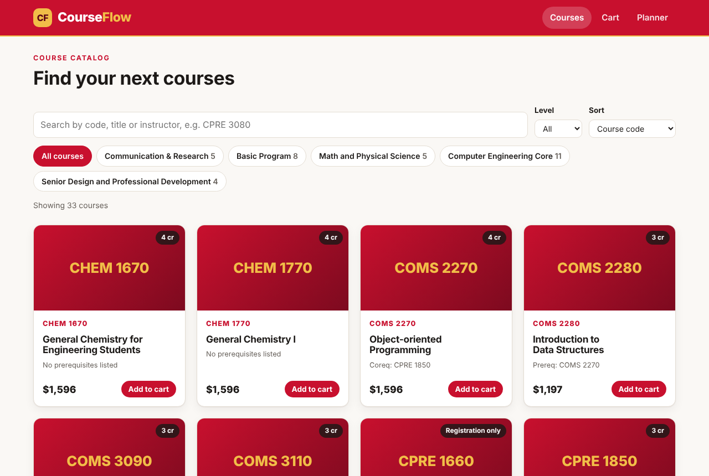
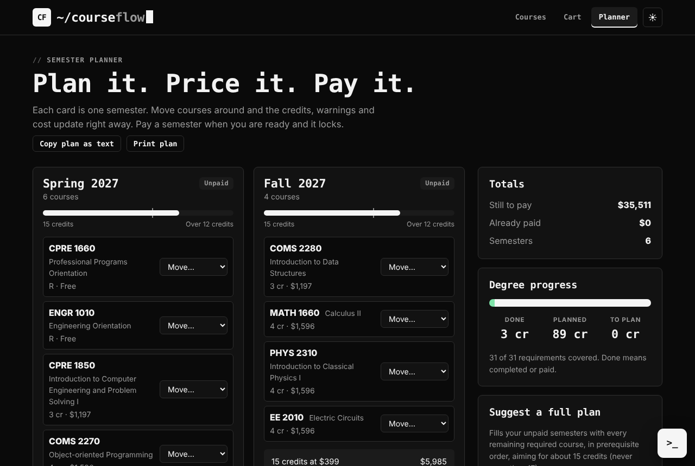
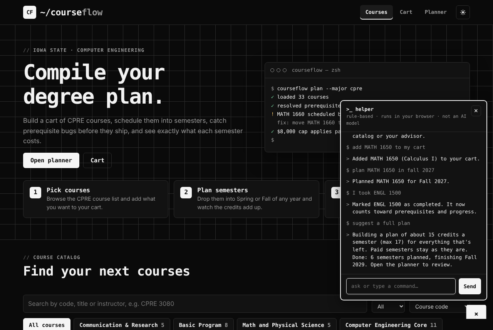
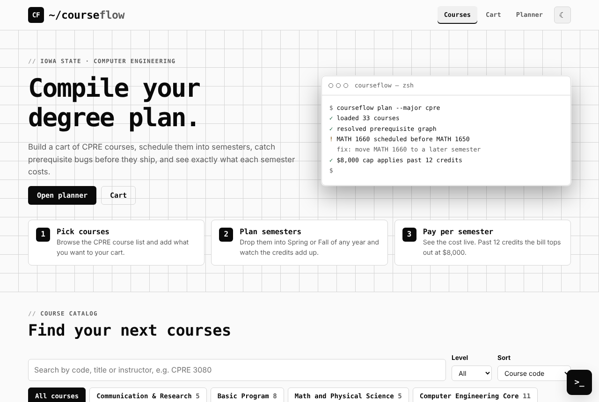

# CourseFlow

A planning tool for **Iowa State CPRE students**: build a cart of courses, drop them into semesters,
see what each semester costs, and pay one semester at a time.

Expanded from **SkillFlix**, the COM S 3190 Assignment 2 course-browsing app by Kai Gasparovich and
Scott Gray. The original catalog, routing and checkout ideas are the starting point; CourseFlow turns
them into a multi-semester planner.






> Screenshots were captured in an offline sandbox, so course thumbnails show the built-in grid tiles.

## What it does

- **Catalog** of 33 CPRE-track courses with search, category chips, level filter and sorting.
- **Cart** for courses you are considering, with undo toasts.
- **Semester planner**: add any Spring, Summer or Fall for any year, move courses between semesters,
  and see credits, a cost breakdown and warnings live.
- **Tuition rule**: $399 per credit. Over 12 credits a semester is capped at $8,000 (see below).
- **Prerequisite warnings** when a course is scheduled before what it normally needs.
- **Suggest a full plan**: generates a prerequisite-safe plan for everything left, about 15 credits a
  semester, never more than 17, with the orientation courses first and the portfolio assessment last.
- **Already completed** list for transfer credit or past classes, which feeds prerequisites and progress.
- **Degree progress** across the requirement list (done, planned, remaining credits).
- **Per-semester checkout** with validation and a printable receipt. A paid semester locks.
- **Mini assistant** (`>_` button, bottom right). Ask "what do I need before CPRE 3080?", "how does the cap
  work?", "check my plan", or give commands like "add MATH 1650 to my cart", "plan CPRE 2810 in fall 2027",
  "I took ENGL 1500", "suggest a plan". It is a **rule-based helper, not an AI model**: it matches
  patterns, answers from the catalog and your plan, and nothing you type leaves the browser.
- **Black-and-white terminal look** with a dark default, a light theme toggle, mono type, and **glitch
  animations** on primary buttons (hover or focus) and now and then on the hero title. Turned off for
  anyone with reduced-motion enabled.
- Plan **copy-as-text** and **print**. Everything is saved in your browser (localStorage).

## The $8,000 cap

"If the credits go over 12, the price caps at $8,000" is implemented as a **ceiling**:

- 12 credits or fewer: you pay the per-credit total.
- Over 12 credits: you pay the per-credit total, but never more than $8,000.

At $399 a credit the ceiling only starts lowering a bill at **21 credits**. If you meant a **flat**
$8,000 for any semester over 12 credits, change `CAP_MODE` to `'flat'` in `src/config.js`; pricing,
UI text and tests already support both. The cap numbers all live in that file.

## Things to know

- **Prerequisites are advisory.** `src/data/prerequisites.js` is a planning aid, not the official ISU
  catalog. Check your curriculum sheet and advisor.
- **Pick-one requirements.** CHEM 1670/1770 and ENGL 3140/3090 are treated as either-or slots. That is an
  assumption; edit `src/data/requirements.js` if your plan differs.
- **Registration-only courses (R)** count as 0 credits and $0, including ENGR 1010, whose source row
  listed a price.
- **Payment is a demo.** Card numbers are validated (Luhn, expiry) in the browser and never stored or
  sent anywhere. Only a receipt with no card data is kept.
- Not affiliated with Iowa State University.

## Run it

```bash
npm install
npm run dev      # start the dev server
npm test         # unit tests (Node's built-in runner)
npm run lint
npm run build
```

Stack: React 19, Vite, Tailwind CSS 4 (imported; the UI runs on its own hand-written CSS in `src/styles`), react-router-dom 7, JetBrains Mono and Inter via Fontsource.

## Project layout

```
src/
  config.js            pricing numbers, cap mode, terms
  data/                catalog, prerequisites, requirement slots
  state/               pure reducer + selectors, React context
  utils/               pricing, semesters, prereq checks, plan generator, checkout, filters, assistant
  components/ pages/   UI
tests/                 node:test suites for all of the logic above
```

The rules (pricing, prerequisites, plan generation, reducer, checkout validation, filtering) are plain
JavaScript with no dependencies, so they run in Node without a browser.
